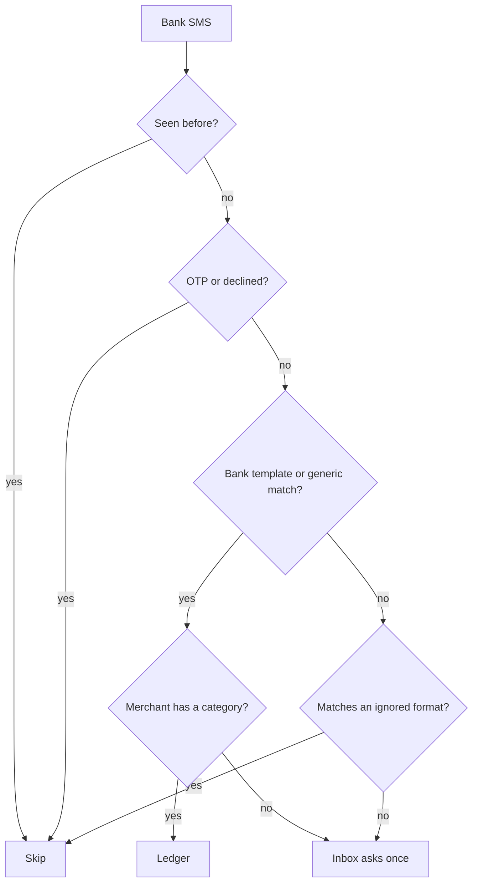

# Masareef

**See where your money goes, straight from your bank SMS.**

Offline · Android · No account · No internet permission

## What it does

- **Reads your bank SMS** (QNB, CIB, FAB Misr, NBE, Banque Misr, InstaPay,
  wallets and more) in English and Arabic, including Arabic digits.
- **Sorts payments into categories.** A new merchant is asked about once,
  then every past and future payment there is filed automatically.
- **Cash withdrawals and transfers you send** count as their own line until
  you say where the money went: all of it in one tap (e.g. 52,500 →
  Installments) or part of it at a time.
- **Never counts twice.** Every SMS has a fixed identity; syncing again or
  rescanning a year adds nothing that is already there.
- **Learns from what it can't read.** Unreadable bank messages go to the
  Inbox: ignore that wording forever (offers, notices), type the payment in,
  or hide just that one. The Log keeps a list you can copy so the next
  version reads them, and an update re-reads old failures.
- **Any date range**: this month, 7 days, all, or custom.
- **Updates keep your data**: same app id and signing key on every build,
  plus copy/paste backup.

## Install

1. Open **Releases** → latest → download `masareef.apk` on your phone.
2. Open it and allow installing from your browser if asked.
3. Open Masareef and allow SMS access. It syncs on every launch.

## How it reads SMS

Patterns live in [`assets/parser/patterns.json`](assets/parser/patterns.json),
tested against real message shapes in
[`test/fixtures/sms_samples.json`](test/fixtures/sms_samples.json).

## Development

Rules, architecture and the build pipeline are in [`CLAUDE.md`](CLAUDE.md).
Every push to `main` is format-checked, analyzed in strict mode, tested,
built and released by GitHub Actions.
